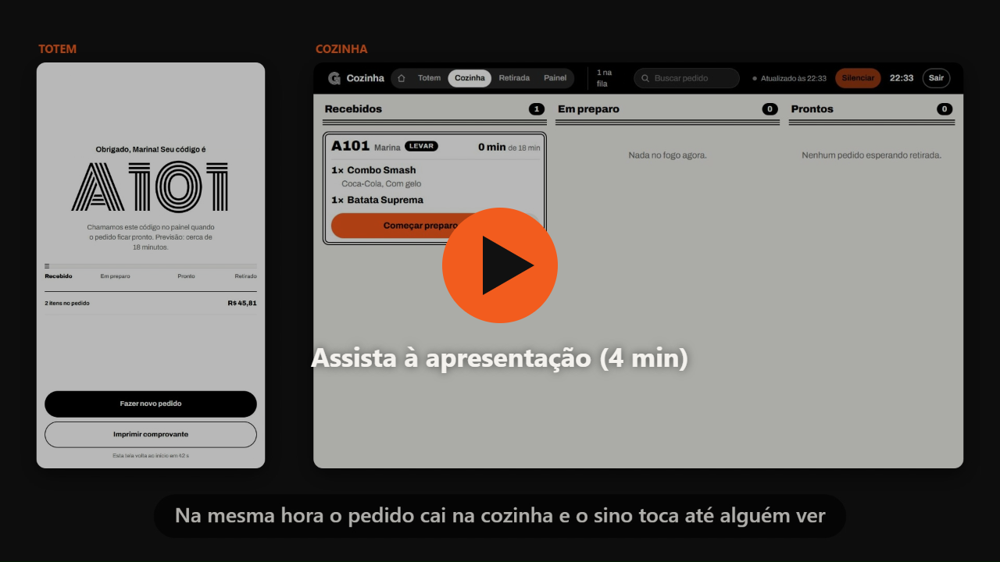
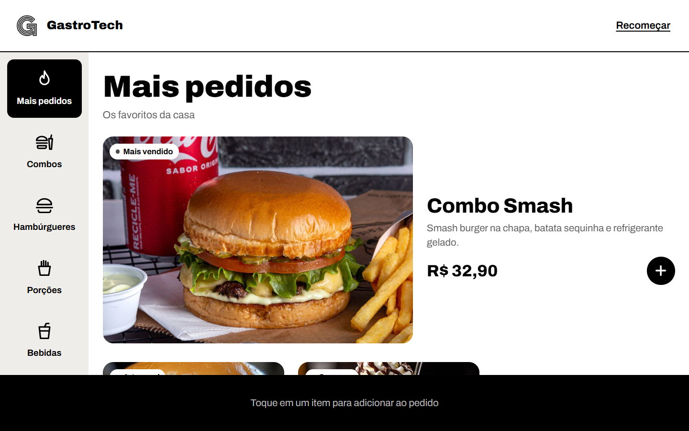
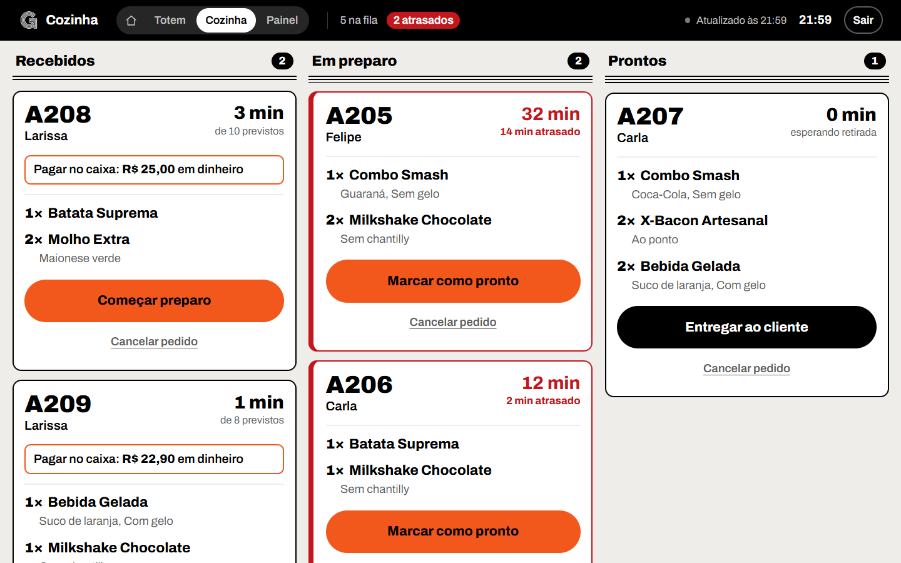
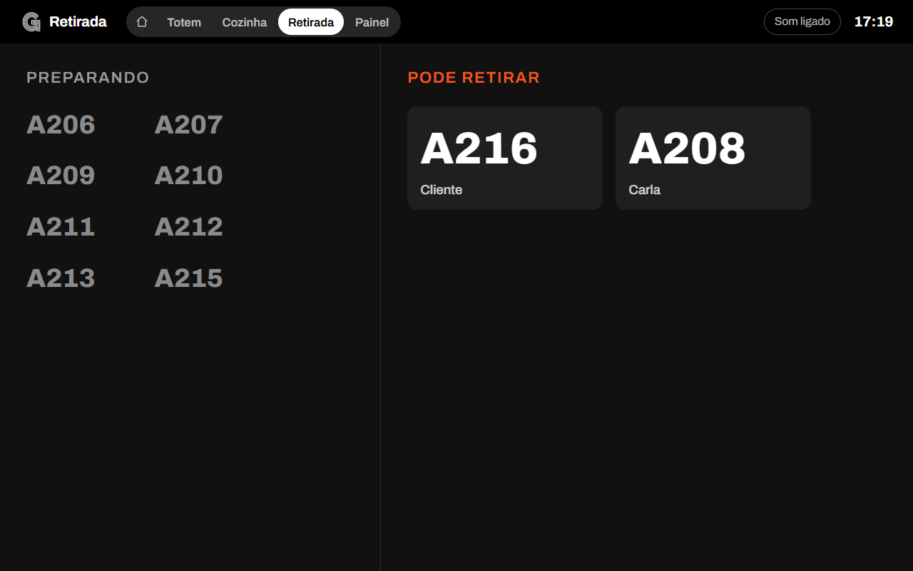

# GastroTech

[](https://github.com/luizajmm/gastrotech/actions/workflows/testes.yml)

Sistema de pedidos pra lanchonete. O cliente monta o pedido no totem, o pedido cai na tela da cozinha, a TV do balcão chama quando fica pronto e o dono acompanha tudo pelo painel (cardápio, vendas, caixa e equipe).

Esse é o projeto integrador do meu 2º semestre de Sistemas de Informação no SENAC. A primeira versão foi feita em grupo, em PHP puro, e está em [tcc-pi2/Sistema-Administrativo](https://github.com/tcc-pi2/Sistema-Administrativo). Depois eu reconstruí o sistema separando em uma API em Laravel e um front em Angular.

**[Ver demonstração](https://luizajmm.github.io/gastrotech/)**: roda direto no navegador, com dados de exemplo. Na cozinha e no painel é só escolher um dos acessos de teste.

[](https://luizajmm.github.io/gastrotech/apresentacao.mp4)

Vídeo de 4 minutos com som: o pedido saindo do totem e chegando na cozinha, a TV chamando o cliente e o painel do administrador com os cadastros. Também dá pra [baixar na versão 1.0](https://github.com/luizajmm/gastrotech/releases/tag/v1.0).



| Cozinha | Painel |
|---|---|
|  |  |



## O que tem

- **Totem:** comer aqui ou para levar, cardápio por categoria, personalização dos lanches (bebida do combo, ponto da carne...), cupom de desconto, cartão fidelidade pelo celular, pagamento por pix, cartão ou dinheiro, comprovante impresso e acompanhamento do pedido pelo código (onde o cliente também avalia o pedido)
- **Cozinha:** fila com recebidos, em preparo e prontos, tempo de cada pedido, aviso de atraso, comanda impressa e um sino que fica tocando até alguém ver o pedido novo
- **Retirada:** tela pra TV do balcão com os pedidos em preparo e os prontos; quando um fica pronto, o código aparece grande e toca o sino
- **Painel:**
  - visão geral do dia com horário de pico, tempo real de preparo e nota dos clientes
  - histórico de pedidos (dá pra cancelar por ali também)
  - cardápio com ficha técnica: cada lanche gasta pão, carne, queijo... e o insumo tem estoque próprio
  - promoções: cupons e o cartão fidelidade
  - financeiro com abertura e fechamento de caixa e planilha das vendas pro contador
  - equipe e configurações da loja
- **Login da equipe** com papéis: cada pessoa só vê e mexe no que é da função dela

## O que mudou da versão antiga

- dava pra excluir coisa só abrindo um link, agora só com login e pelo método certo
- as permissões existiam no banco mas não eram usadas
- o código do pedido podia repetir quando dois totens pediam juntos
- pedido em dinheiro já nascia como pago, agora espera o caixa confirmar
- a cozinha só atualizava recarregando a página
- tem testes automatizados na api

## Tecnologias

- `api/`: PHP 8.2, Laravel 12, MySQL
- `web/`: Angular, TypeScript, HTML e CSS

O desenho das tabelas e o porquê de algumas escolhas estão em [docs/banco.md](docs/banco.md).

A cada push, o GitHub Actions roda os testes da api e o build do front.

## Demonstração

A [demonstração](https://luizajmm.github.io/gastrotech/) é o mesmo front, mas sem a api: as chamadas são respondidas no próprio navegador, com um banco de exemplo em memória (some quando recarrega a página). Esse código fica só na branch `demonstracao`, em `web/src/demo`, pra não misturar com o sistema de verdade.

## Como rodar

Precisa do XAMPP (MySQL e PHP 8.2), do Composer e do Node.js.

1. No XAMPP, liga o **MySQL** e cria um banco chamado `gastrotech` no phpMyAdmin
2. Na pasta `api`, roda o `instalar.bat` (só na primeira vez) e depois o `iniciar.bat`
3. Na pasta `web`, roda:

```bash
npm install
npm start
```

4. Abre http://localhost:4200

Os usuários de teste estão no [README da api](api/README.md#usuários-de-teste).
