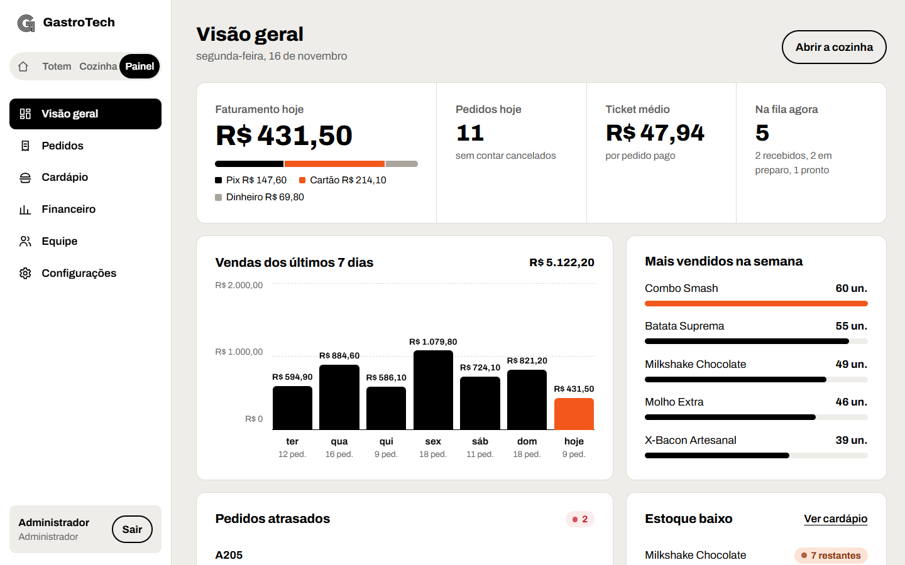

# GastroTech

Sistema de pedidos pra lanchonete. O cliente monta o pedido no totem, o pedido cai na tela da cozinha e o dono acompanha tudo pelo painel (cardápio, vendas, caixa e equipe).

Esse é o projeto integrador do meu 2º semestre de Sistemas de Informação no SENAC. A primeira versão foi feita em grupo, em PHP puro, e está em [tcc-pi2/Sistema-Administrativo](https://github.com/tcc-pi2/Sistema-Administrativo). Depois eu reconstruí o sistema separando em uma API em Laravel e um front em Angular.

**[Ver demonstração](https://luizajmm.github.io/gastrotech/)**: roda direto no navegador, com dados de exemplo. Na cozinha e no painel é só escolher um dos acessos de teste.


| Cozinha | Painel |
|---|---|
|  |  |

## O que tem

- **Totem:** cardápio por categoria, personalização dos lanches (bebida do combo, ponto da carne...), pagamento por pix, cartão ou dinheiro e acompanhamento do pedido pelo código
- **Cozinha:** fila com recebidos, em preparo e prontos, tempo de cada pedido e aviso de atraso
- **Painel:** visão geral do dia, histórico de pedidos, cadastro de produtos e categorias, financeiro com abertura e fechamento de caixa, equipe e configurações da loja
- **Login da equipe** com papéis: cada pessoa só vê e mexe no que é da função dela

## O que mudou da versão antiga

- dava pra excluir coisa só abrindo um link, agora só com login e pelo método certo
- as permissões existiam no banco mas não eram usadas
- o código do pedido podia repetir quando dois totens pediam juntos
- pedido em dinheiro já nascia como pago, agora espera o caixa confirmar
- a cozinha só atualizava recarregando a página
- tem testes automatizados na api

## Tecnologias

- `api/`: PHP 8.2, Laravel 12, MySQL
- `web/`: Angular, TypeScript, HTML e CSS

## Como rodar

Precisa do XAMPP (MySQL e PHP 8.2), do Composer e do Node.js.

1. No XAMPP, liga o **MySQL** e cria um banco chamado `gastrotech` no phpMyAdmin
2. Na pasta `api`, roda o `instalar.bat` (só na primeira vez) e depois o `iniciar.bat`
3. Na pasta `web`, roda:

```bash
npm install
npm start
```

4. Abre http://localhost:4200

Os usuários de teste estão no [README da api](api/README.md#usuários-de-teste).
