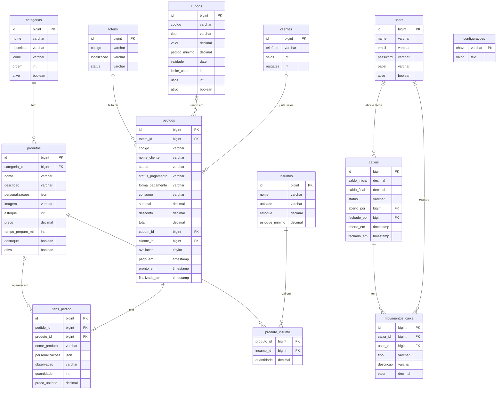

# Banco de dados

MySQL, criado pelas migrations em `api/database/migrations`.

Os produtos também têm `destaques`, `ingredientes`, `tags`, `alergenos`, `porcao` e `calorias`, que só aparecem no totem. Tirei do desenho pra não ficar enorme.

As tabelas do próprio Laravel (`sessions`, `personal_access_tokens`, `cache`, `jobs`...) ficaram de fora.

## Por que ficou assim

- **o item guarda o nome e o preço do produto.** Se alguém mudar o preço depois, o histórico dos pedidos antigos não muda
- **apagar uma categoria não apaga os produtos.** Eles só ficam sem categoria (`nullOnDelete`)
- **apagar um produto ou um totem não apaga os pedidos.** O pedido continua no histórico e no financeiro
- **pedido nunca é apagado, só cancelado.** Senão o caixa e os relatórios param de bater
- **o `codigo` do pedido (A101, A102...) é gerado depois de salvar, a partir do id.** Na versão antiga era `MAX(id) + 1` e repetia quando dois totens pediam ao mesmo tempo
- **o status do pedido e do pagamento são separados.** Um pedido pode estar pronto e ainda não pago (dinheiro no balcão)
- **as personalizações são json.** Cada produto tem as suas (bebida do combo, ponto da carne, gelo...), então não fazia sentido uma tabela pra cada
- **`subtotal` é a soma dos itens e `total` é o que o cliente pagou.** O financeiro soma o `total`, então desconto de cupom ou do cartão fidelidade já sai do faturamento
- **o pedido guarda o código do cupom além do `cupom_id`.** Se o cupom for apagado, o histórico continua mostrando qual foi usado. Cupom que já foi usado não é apagado, só desativado
- **o cartão fidelidade só guarda o celular.** Sem nome, sem CPF; no painel o número aparece escondido
- **insumo tem estoque decimal** porque bacon é em gramas e sorvete em ml. O produto continua com o estoque próprio dele (bebida em lata, por exemplo), e o totem mostra o menor dos dois
- **`configuracoes` é chave/valor** pra dar pra adicionar coisa nova (nome da loja, frase do totem, logo) sem mexer na estrutura
